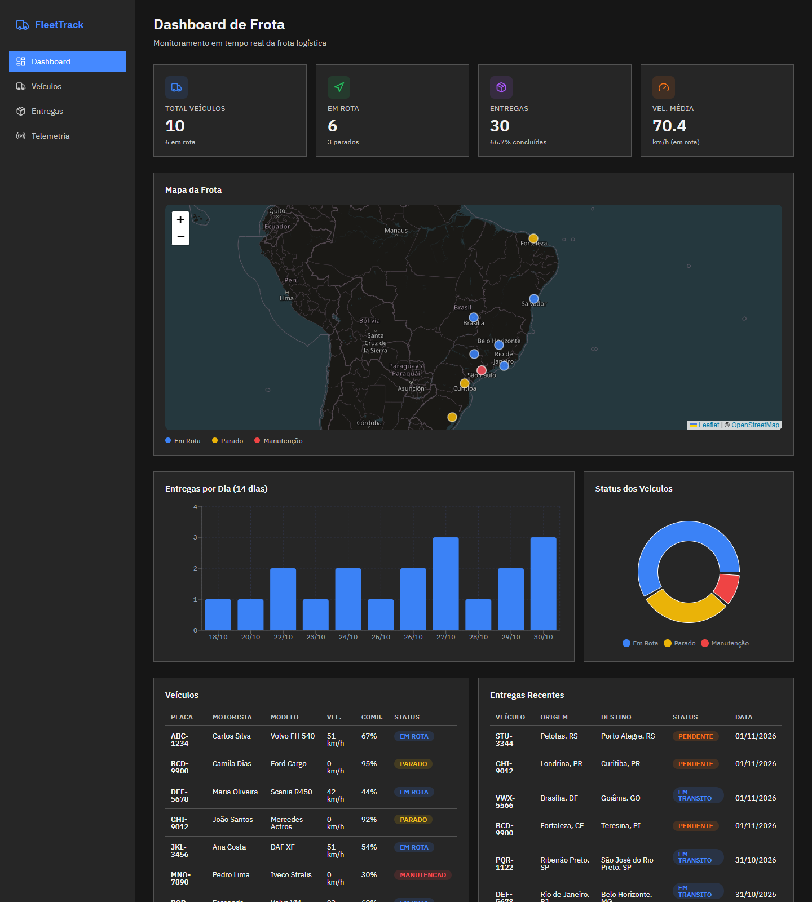
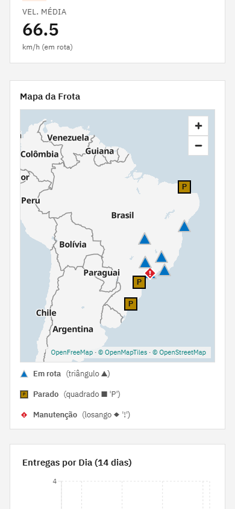
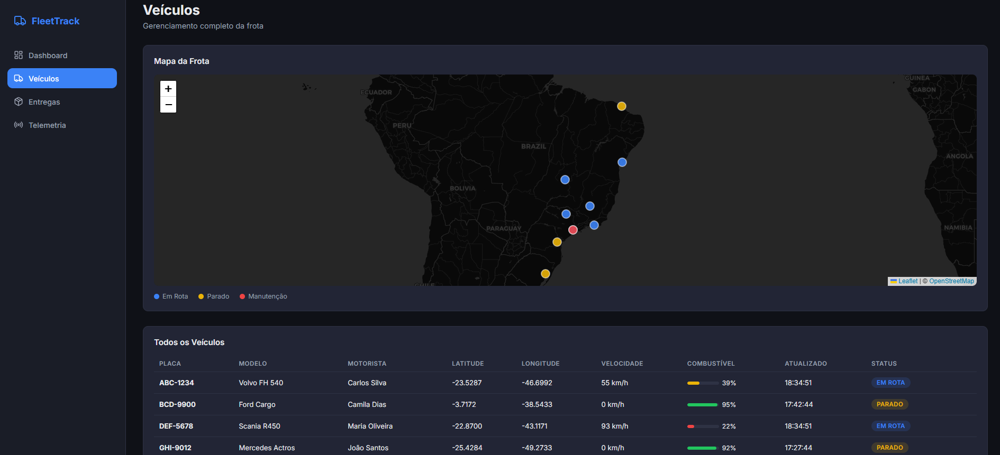
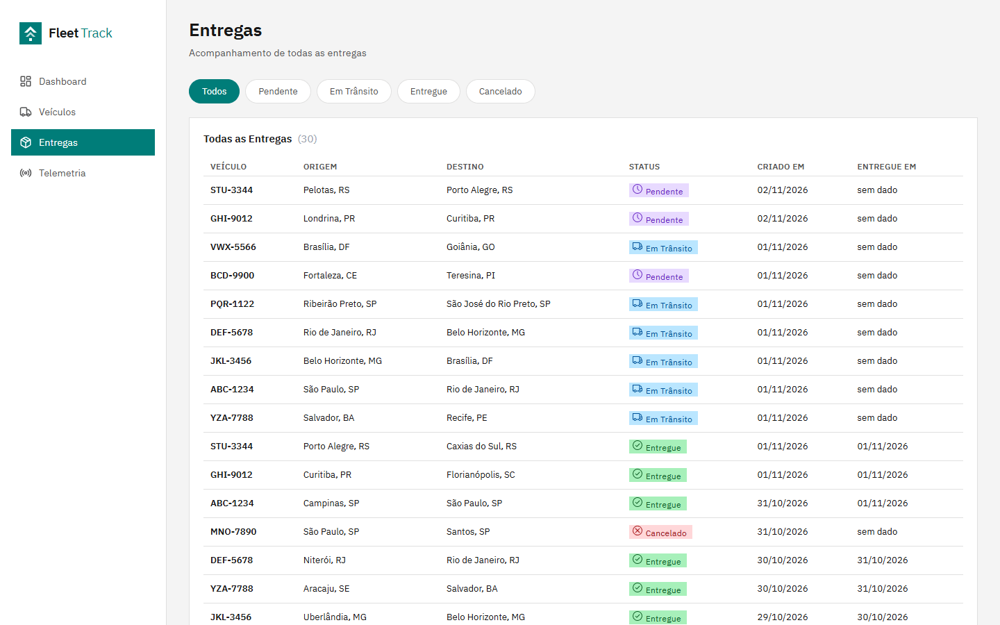
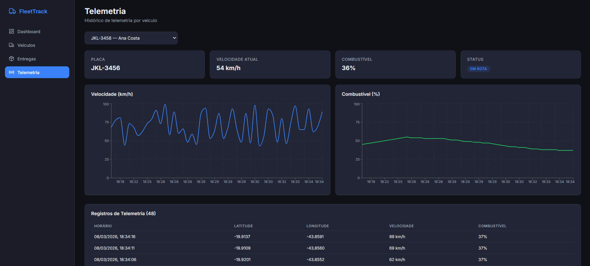
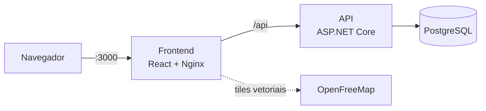

<div align="center">


# FleetTrack

**Painel open source para acompanhar uma frota logística: onde está cada veículo, como andam as entregas e o que diz a telemetria.**

[](LICENSE)




</div>

> [!WARNING]
> **Em desenvolvimento: sem autenticação até a v1.0. Não use com dados reais.**
> A API e o painel ainda estão abertos para quem alcançar a máquina. Rode só em ambiente local ou de teste.

### Mapa de fundo e privacidade

Por padrão, o navegador de quem abre o FleetTrack baixa o mapa de fundo vetorial do OpenFreeMap (Hyperknot Software Kft., Hungria), passando pela Cloudflare.

- **O que o provedor recebe a cada pedido:** o endereço IP, os dados do navegador, o endereço desta instalação (`Origin`) e os blocos de mapa pedidos, que revelam a área e o zoom consultados. Quando alguém amplia o mapa sobre um veículo, a área pedida fica perto dele.
- **O que NÃO recebe:** placas, nomes, entregas, rotas e quaisquer dados da API do FleetTrack.
- **Declarações e termos do provedor:** registros de acesso sem IP; registros de erro com IP e URL, apagados em 7 dias; registro de IP por até 30 dias em incidente de segurança. A Cloudflare tem política própria. O serviço é oferecido "no estado em que se encontra" (AS-IS), sem garantia ou SLA, e pode acabar sem aviso prévio. Os termos exigem ao menos 18 anos e adotam a lei húngara, com arbitragem em Budapeste.
- **Sua responsabilidade:** como controlador, avalie a base legal, informe operadores e motoristas e avalie a transferência internacional (LGPD, art. 33).
- **Como desligar (para não enviar nada):** deixe `MAP_TILEJSON_URL` e `MAP_CSP_ORIGINS` vazias nas variáveis de ambiente. O painel continuará funcionando normalmente com todos os marcadores, popups e tabelas sobre fundo liso. Para apontar para outro serviço no esquema OpenMapTiles, utilize as variáveis `MAP_*`.

> Este resumo não é aconselhamento jurídico.

## O que ele faz

- **Visão geral da frota:** total de veículos, quantos estão em rota, entregas concluídas e velocidade média, atualizados sozinhos.
- **Mapa ao vivo:** cada veículo aparece no mapa com a cor do status (em rota, parado, manutenção).
- **Entregas:** a lista completa com filtro por status (pendente, em trânsito, entregue, cancelado).
- **Telemetria por veículo:** gráficos de velocidade e combustível ao longo do tempo e o histórico de posições.
- **Dados de demonstração:** a instalação já vem com 10 veículos e 30 entregas, e a movimentação é simulada para você ver o painel funcionando na hora.

## Telas

As imagens abaixo são capturas da versão atual rodando com os dados de demonstração, no tema claro. O painel também tem tema escuro e se adapta ao celular.

### Dashboard

Indicadores da frota, mapa, entregas por dia nos últimos 14 dias, status dos veículos e as entregas mais recentes.


No celular (390 px de largura):



### Veículos

O mapa da frota e a tabela de todos os veículos, com posição, velocidade, combustível, última atualização e status.



### Entregas

Todas as entregas, com filtro por status.



### Telemetria

Escolha um veículo para ver velocidade e combustível ao longo do tempo e os registros de posição.



## Como rodar

Você só precisa do [Docker](https://docs.docker.com/get-docker/) com o Docker Compose.

```bash
git clone https://github.com/gabrielgomeslira/Fleet-Track.git
cd Fleet-Track
cp .env.example .env      # no Windows (PowerShell): Copy-Item .env.example .env
```

Abra o `.env` e **troque a senha do banco** (`POSTGRES_PASSWORD` e a mesma senha dentro de `CONNECTION_STRING`). Depois:

```bash
docker compose up --build
```

Acesse **http://localhost:3000**. Na primeira subida, o banco é criado e populado com os dados de demonstração.

Para parar, use `docker compose down`. Para apagar também os dados, use `docker compose down -v`.

> **Atualizando de uma versão anterior à v1.0?** O esquema do banco agora é criado e versionado pela API (migrações do EF Core), e a base antiga não é migrada. Recrie-a com `docker compose down -v` antes de subir de novo. Isso apaga os dados de demonstração da instalação antiga.

### Variáveis de ambiente

| Variável | Para que serve | Exemplo |
|---|---|---|
| `POSTGRES_USER` | Usuário do banco | `admin` |
| `POSTGRES_PASSWORD` | Senha do banco. **Troque.** | — |
| `POSTGRES_DB` | Nome do banco | `fleetdb` |
| `POSTGRES_PORT` | Porta do banco no seu computador | `5432` |
| `BACKEND_PORT` | Porta da API no seu computador | `5000` |
| `FRONTEND_PORT` | Porta do painel no seu computador | `3000` |
| `CONNECTION_STRING` | Conexão da API com o banco (usa as variáveis acima) | `Host=db;Port=5432;Database=fleetdb;Username=admin;Password=...` |

#### Mapa

O fundo do mapa vem de um provedor externo (padrão: OpenFreeMap). **O navegador de quem usa o painel** pede os tiles direto a ele, e o provedor vê o IP e a região visualizada. Para não enviar nada a terceiros, deixe `MAP_TILEJSON_URL` e `MAP_CSP_ORIGINS` vazias: o painel segue funcionando, com os veículos sobre fundo liso. Não recompila nada; basta reiniciar o container `frontend`.

| Variável | Padrão | Para que serve |
|---|---|---|
| `MAP_TILEJSON_URL` | `https://tiles.openfreemap.org/planet` | TileJSON no esquema OpenMapTiles. **Vazia, desliga o fundo.** |
| `MAP_GLYPHS_URL` | `https://tiles.openfreemap.org/fonts/{fontstack}/{range}.pbf` | Glifos (precisa de `Noto Sans Regular` e `Noto Sans Bold`) |
| `MAP_STYLE_URL` | vazia | Estilo completo próprio; substitui as duas acima e não acompanha o tema |
| `MAP_CSP_ORIGINS` | `https://tiles.openfreemap.org` | Origens em `connect-src`, separadas por espaço. Vazia se o fundo estiver desligado |
| `MAP_CREDIT` | `OpenFreeMap\|https://openfreemap.org;© OpenMapTiles\|https://www.openmaptiles.org/` | Crédito do provedor, em pares `texto\|link` |

O painel lê esses valores de `/config/mapa.json`, gerado na subida do container. Só aceita URLs `https`; se o arquivo faltar ou for inválido, o fundo fica desligado.

Se a porta 5432 já estiver ocupada por outro PostgreSQL, mude `POSTGRES_PORT` (por exemplo, `55432`). A API continua falando com o banco pela rede interna do Compose.

## Como funciona



- O **frontend** é um app React servido pelo Nginx, que também encaminha `/api` para o backend.
- O **backend** é uma API ASP.NET Core com Entity Framework Core.
- O **banco** é um PostgreSQL 16. A API cria e atualiza o esquema na subida, com as [migrações do EF Core](backend/Migrations), e, no modo demo (`FLEET_DEMO_MODE=true`) com as tabelas vazias, grava os dados de demonstração ([`SeedDemonstracao.cs`](backend/Data/SeedDemonstracao.cs)). Para migrar sem subir a API, use `dotnet FleetApi.dll migrate`.
- O **mapa** usa MapLibre GL carregado sob demanda (chunk próprio) com tiles vetoriais do OpenFreeMap em estilo próprio sem vegetação, relevo ou pontos de interesse. Oferece suporte completo a teclado (WCAG 2.2 AA) e respeita temas claro e escuro. Para desativar ou trocar o provedor, consulte a seção [Mapa de fundo e privacidade](#mapa-de-fundo-e-privacidade) e as [variáveis de ambiente do mapa](#mapa).

### Tecnologias

| Camada | Stack |
|---|---|
| Frontend | React 19, TypeScript, Vite, Recharts, MapLibre GL, IBM Carbon, Lucide |
| Backend | .NET 10, ASP.NET Core, Entity Framework Core, Npgsql |
| Banco | PostgreSQL 16 |
| Infra | Docker Compose, Nginx |
| Qualidade | ESLint, Prettier, `tsc --noEmit`, xUnit |

## API

Todas as rotas respondem JSON. Pelo painel, use `http://localhost:3000/api/...`.

| Método | Rota | O que faz |
|---|---|---|
| GET | `/api/vehicles` | Lista os veículos |
| GET | `/api/vehicles/{id}` | Detalhes de um veículo |
| GET | `/api/deliveries` | Lista as entregas (filtro: `?status=pendente\|em_transito\|entregue\|cancelado`) |
| GET | `/api/deliveries/{id}` | Detalhes de uma entrega |
| GET | `/api/telemetry/{vehicleId}` | Histórico de telemetria de um veículo |
| GET | `/api/dashboard/stats` | Números agregados do dashboard |

Não há endpoint de simulação. No modo demo (`FLEET_DEMO_MODE=true`, padrão `false`), um job do backend move os veículos em rota a cada 30 s, ao longo do trajeto da entrega em andamento, e grava um registro de telemetria para todos os veículos.

Exemplo:

```bash
curl http://localhost:3000/api/dashboard/stats
```

A API vai mudar antes da v1.0: rotas versionadas em `/api/v1`, autenticação e chaves de API para integrações. As decisões estão em [`docs/adr`](docs/adr).

## Estrutura do repositório

```
backend/     API ASP.NET Core (controllers, modelos, migrações e dados de demonstração)
frontend/    Painel React + Vite, servido pelo Nginx
docs/        Documentação, decisões de arquitetura (adr/) e imagens
.github/     Templates de issue e PR e CODEOWNERS
```

## Desenvolvimento

Frontend:

```bash
cd frontend
npm ci
npm run dev         # servidor de desenvolvimento
npm run lint        # ESLint
npm run typecheck   # checagem de tipos
npm run build       # build de produção
```

Backend:

```bash
dotnet restore --locked-mode
dotnet build
dotnet test         # precisa de um PostgreSQL de teste; veja tests/README.md
```

Commits seguem o [Conventional Commits](https://www.conventionalcommits.org/pt-br/) em português. O passo a passo para contribuir está no [CONTRIBUTING.md](CONTRIBUTING.md).

## Rumo à v1.0

- [x] Licença, guia de contribuição, código de conduta e política de segurança
- [x] Padrões de código (EditorConfig, ESLint, Prettier) e checagem de tipos
- [x] Decisões de arquitetura documentadas em `docs/adr`
- [ ] CI com build, testes e varredura de segredos
- [ ] Autenticação no painel e chaves de API para sistemas
- [ ] API pública versionada (`/api/v1`) com OpenAPI
- [ ] Simulação só no modo demo
- [ ] Imagens publicadas por release

## Contribuindo

Contribuições são bem-vindas. Leia o [CONTRIBUTING.md](CONTRIBUTING.md) e o [Código de Conduta](CODE_OF_CONDUCT.md) antes de abrir um PR.

Achou uma vulnerabilidade? Não abra issue pública: siga o [SECURITY.md](SECURITY.md).

## Licença

[MIT](LICENSE) © Gabriel Gomes

Créditos: interface com [IBM Carbon Design System](https://carbondesignsystem.com/) (Apache-2.0) e fonte [IBM Plex](https://www.ibm.com/plex/) (OFL-1.1). As capturas do mapa usam dados do OpenStreetMap, servidos pelo OpenFreeMap (© OpenMapTiles).
